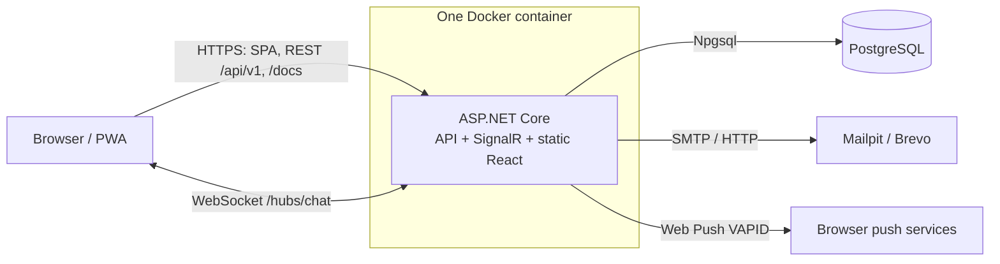
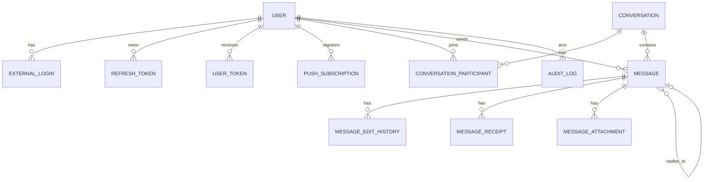

# Migly Messenger

**Migly** is a real-time messenger for a study group — personal and group chats, live delivery and read receipts, typing and presence — with a production-style REST API and its own authentication. One project, two labs: **Lab 01 “Mini Messenger” (Advanced)** and **Lab 21 “REST API with Real Auth” (Advanced)**.

- **Live app:** [Migly Messenger](https://messenger-pa0l.onrender.com)
- **API docs:** `/docs` (Scalar UI over the OpenAPI document at `/openapi/v1.json`)

## Make it yours

**Theme + community + language (option B + A).** Migly is the chat of “Room 412”, a dorm study crew. The UI uses a **Neumorphism** (“soft UI”) theme — one calm background, depth from paired light/dark shadows, raised cards and pressed inputs — with automatic light and dark variants. The whole look lives in CSS tokens in [`client/src/styles/theme.css`](client/src/styles/theme.css), so the theme is swapped by editing one file. The interface speaks **Ukrainian and English** (switch in the sidebar, on the sign-in screen or in Settings); the API and emails answer in the language of the `Accept-Language` header. Why: the crew are Ukrainian students who also write their lab reports in English, and a soft, quiet UI suits a chat that stays open all day.

### Languages

- **Client:** resource files [`client/src/i18n/locales/uk.json`](client/src/i18n/locales/uk.json) and [`en.json`](client/src/i18n/locales/en.json) (flat keys, `{param}` placeholders, plural forms via `Intl.PluralRules` — Ukrainian `_one/_few/_many/_other`, English `_one/_other`). The choice is remembered in the browser; the first visit follows the browser language (English browsers get English, everyone else Ukrainian). Dates and times use the selected locale. A test checks that both files have the same keys.
- **Server:** `.resx` resources — [`ApiMessages.uk.resx`](server/src/Messenger.Api/Resources) for error and validation messages (translated at the API boundary, so the domain stays framework-free) and [`EmailTexts.*.resx`](server/src/Messenger.Application/Resources) for verification / reset emails; English is the neutral resource (`ApiMessages.resx`, `EmailTexts.resx`). Supported `Accept-Language`: `en` (default, also for curl and the API docs) and `uk`; any other language falls back to English.

## Levels and side quests

| Lab | Level | Covered by |
|---|---|---|
| Lab 01 Basic | users, conversations, messages, persistence, empty messages rejected, ordered history | per-conversation `Sequence`, PostgreSQL |
| Lab 01 Standard | runtime registration, ≥ 3-person groups, validation, **search**, storage-failure handling, layered code | Clean Architecture, 503 ProblemDetails on DB outage |
| Lab 01 Advanced | client-server live (SignalR), auth, Sent/Delivered/Read, edit/delete with history, groups, typing, web UI | React SPA + `/hubs/chat` |
| Lab 21 Basic | ≥ 5 CRUD endpoints, migrations, 422 / status codes, `/docs`, curl | controllers under `/api/v1` |
| Lab 21 Standard | register/login, BCrypt, JWT, per-user scoping (BOLA tests), env secrets, README with curl | see below |
| Lab 21 Advanced | rate limiting, RBAC (system admin), password reset, pagination, structured logging, tests, CI | all of them |
| Extensions | React client (“Lab 22”), SignalR (“Lab 23”), refresh rotation with reuse detection, OAuth (Google/GitHub, off until configured), Web Push + PWA, audit log, attachment metadata, sessions list | |

## Run locally (≤ 5 commands)

Prerequisites: Docker, .NET 9 SDK, Node 22.

```bash
docker compose up -d postgres mailpit
dotnet run --project server/src/Messenger.Api --launch-profile http
```

```bash
cd client && npm install && npm run dev
```

Open http://localhost:5173 (Ukrainian by default; switch to English with the UK/EN control). Emails (verification, password reset) land in Mailpit at http://localhost:8025. Optional demo data (6 users incl. an admin, a group and five personal chats; Alice starts with unread messages — 5 from Bohdan, 2 from Dmytro, 1 from Iryna — so the unread badges and the AI summary can be tried at once; password from `Seed:Password` — the Development default is `Migly-demo-2026`):

```bash
dotnet run --project server/src/Messenger.Api --launch-profile http -- seed
```

Then sign in as `alice@migly.local`. Admin: `admin@migly.local`. The production image: `docker build -t messenger . && docker run -p 10000:10000 -e ConnectionStrings__Default=... -e Jwt__Secret=... messenger`.

## curl examples

```bash
BASE=http://localhost:5000
# 1. Register (202; the confirmation link is emailed — see Mailpit locally)
curl -X POST $BASE/api/v1/auth/register -H 'Content-Type: application/json' \
  -d '{"email":"alice@example.com","password":"S3cure-pass-123","username":"alice","displayName":"Alice"}'
# 2. Log in → {"accessToken": "...", "expiresAt": "...", "user": {...}} (+ HttpOnly refresh cookie)
TOKEN=$(curl -s -X POST $BASE/api/v1/auth/login -H 'Content-Type: application/json' \
  -d '{"email":"alice@example.com","password":"S3cure-pass-123"}' | sed -E 's/.*"accessToken":"([^"]+)".*/\1/')
# 3. Protected call (200), and without a token (401)
curl $BASE/api/v1/users/me -H "Authorization: Bearer $TOKEN"
curl -i $BASE/api/v1/users/me
# 4. Send a personal message (creates the chat on the first message)
curl -X POST $BASE/api/v1/conversations/direct/<peerUserId>/messages -H "Authorization: Bearer $TOKEN" \
  -H 'Content-Type: application/json' -d '{"clientMessageId":"0192f0c4-7d4e-7a3b-9f10-3c2a1b0e9d11","body":"Hey, are you ready for class?"}'
# 5. Empty message → 422 with errors.body
curl -X POST $BASE/api/v1/conversations/direct/<peerUserId>/messages -H "Authorization: Bearer $TOKEN" \
  -H 'Content-Type: application/json' -d '{"clientMessageId":"0192f0c4-7d4e-7a3b-9f10-3c2a1b0e9d12","body":"   "}'
```

The full request collection is in [docs/requests.http](docs/requests.http); `scripts/smoke.sh <base-url>` runs register → verify (via Mailpit) → login → protected call → 401.

## Tech stack

ASP.NET Core 9 (controllers, request localization + .resx) · MediatR 12 (CQRS pipeline: Logging → Validation → Authorization → Transaction) · FluentValidation · EF Core 9 + Npgsql (PostgreSQL 16) · SignalR · BCrypt.Net-Next · JWT (HS256) · Serilog (compact JSON) · OpenAPI + Scalar · built-in rate limiting · React 19 + Vite + TypeScript · own i18n (uk/en JSON resources) · TanStack Query · Zustand · react-virtuoso · @microsoft/signalr · xUnit, Shouldly, NSubstitute, Testcontainers, NetArchTest · Vitest + Testing Library · Playwright · Docker · GitHub Actions · Render + Neon + Brevo.

## Architecture



```txt
server/src/Messenger.Domain          entities, invariants, domain events, Result — no framework dependencies
server/src/Messenger.Application     commands/queries + handlers, pipeline behaviors, validators, ports
server/src/Messenger.Infrastructure  EF Core, repositories, unit of work + post-commit events, JWT, BCrypt, email, push, seed
server/src/Messenger.Api             controllers, ChatHub, presence, ProblemDetails, rate limiting, OpenAPI — composition root
client/                              React SPA (served from the API's wwwroot in production)
```

Commands change state over REST; the hub only carries events (`MessageReceived`, `MessageStatusChanged`, `Typing`, `PresenceChanged`, …) and ephemeral calls (`AckDelivered`, `MarkRead`, `Typing`, `OpenConversation`, `WatchPresence`).



## How data is stored

Everything lives in PostgreSQL. Sending a message is one database transaction: the conversation row’s counter is bumped with `UPDATE … SET last_sequence = last_sequence + 1 … RETURNING`, which locks that row, so two senders in the same chat are serialised and commit in sequence order; then the message row is inserted with that number. Ordering never depends on timestamps, and a client that resyncs with `after=N` cannot skip a message. Only after the commit succeeds are events pushed over SignalR, so nobody sees a message that was rolled back, and a crash before the commit loses nothing the sender was told was saved. Retrying with the same `clientMessageId` returns the stored message instead of creating a duplicate (unique index). Edits and deletes take a new number from the same counter (`UpdatedSequence`) so offline clients pick them up on resync. Deletion is a tombstone — the text and its edit history are erased, the row and its position stay. Users, groups and messages are soft-deleted. Each member has sequence watermarks (joined-at, cleared-up-to, read-up-to) that every read path applies: history, search, unread counts and statuses. All timestamps are stored in UTC and shown in the viewer’s local time.

## Validation

All text is normalised to Unicode NFC and trimmed on the server. A message must be non-empty, at most 4000 characters (emoji count as one) and free of control characters other than line breaks and tabs. Usernames are 3–32 characters of `a-z 0-9 _ .`, unique ignoring case; display names are 1–64 characters without control characters; passwords are at least 10 characters and at most 72 bytes. Group titles are 1–100 characters and groups start with at least 3 members. Invalid input returns **422** with an RFC 9457 problem document that lists errors per field; malformed JSON is also 422, never 500.

## Free-tier limitations

Render’s free instance sleeps after 15 minutes idle and needs ~50 s to wake (the SPA shows “server is waking up” and reconnects SignalR by itself). Neon’s free database is 1 GB and pauses after 5 minutes idle. Brevo sends at most 300 emails per day. Presence and SignalR groups are in memory, so the app runs as a single instance (scaling out needs a Redis backplane).

**Module documentation:** [docs/documentation](docs/documentation/README.md) (architecture, Domain, Application, Infrastructure, API, realtime, database, client, testing, operations).

Step-by-step deployment guide (Ukrainian): [docs/DEPLOY_STEP_BY_STEP.md](docs/DEPLOY_STEP_BY_STEP.md).

Compliance with the specification: [docs/COMPLIANCE_AUDIT.md](docs/COMPLIANCE_AUDIT.md).

More: [AGENTS.md](AGENTS.md) · [docs/DEPLOYMENT.md](docs/DEPLOYMENT.md) · [docs/ASSUMPTIONS.md](docs/ASSUMPTIONS.md) · [docs/DECISIONS.md](docs/DECISIONS.md) · [docs/TRACEABILITY.md](docs/TRACEABILITY.md) · [docs/OWNERSHIP.md](docs/OWNERSHIP.md) · [docs/REFLECTION.md](docs/REFLECTION.md)
