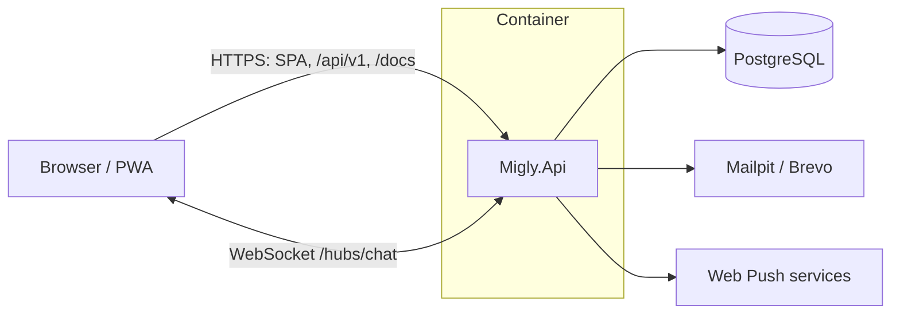
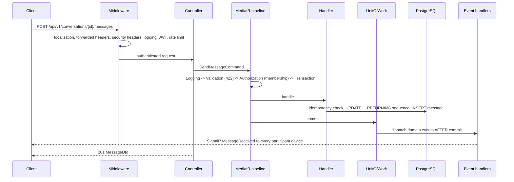

# 1. Architecture overview

## Goals

- One deployable artifact: the ASP.NET Core container serves the REST API, the SignalR hub and the built React app (same origin, no CORS in production).
- Clean Architecture with CQRS: **commands over REST, events over SignalR**.
- Correctness first: message ordering is per conversation, delivery is idempotent, every read path respects visibility watermarks, every resource access is authorised in one place.

## Runtime topology

## Layers

| Layer | Responsibility | Depends on |
|---|---|---|
| Domain | Entities, value rules, domain events, `Result` | nothing |
| Application | Use cases as MediatR requests, pipeline behaviors, ports (interfaces), DTOs | Domain |
| Infrastructure | Implements ports: EF Core/PostgreSQL, JWT, BCrypt, SMTP/Brevo, Web Push, seed, migrator | Application, Domain |
| Api | HTTP and WebSocket surface, composition root, middleware, OpenAPI | Application, Infrastructure |

## Request lifecycle (command)

## Key invariants (do not weaken)

1. **Per-conversation sequence.** `conversations.last_sequence` is incremented with `UPDATE … RETURNING` inside the send transaction. The row lock serialises senders, so commit order equals sequence order. There is no global ordering id. Edits and deletes take a new number from the same counter and store it in `messages.updated_sequence`, so `GET messages?after=N` returns new **and** changed messages.
2. **Idempotent send.** Unique `(sender_id, client_message_id)`. A retry returns the stored message (200 instead of 201).
3. **Visibility watermarks.** Each participant has `VisibleFromSequence` (join) and `ClearedUpToSequence` (chat reset). A message is visible when `sequence > max(VisibleFromSequence − 1, ClearedUpToSequence)`. History, search, unread counts, statuses, message info and event fan-out all apply it.
4. **Events after commit.** Domain events are buffered during `SaveChanges` and published only once the transaction commits. Handler failures are logged and never roll back data.
5. **BOLA guard in one place.** Requests that touch a conversation or message implement `IConversationMemberRequest` / `IMessageAccessRequest`; `AuthorizationBehavior` checks membership before the handler runs. Outsiders get 404, not 403.
6. **Tombstones.** Deleting a message nulls the body, erases edit history and attachments, keeps the row and its sequence.
7. **UTC everywhere** through `IClock`; `DateTime.Now` is never used.
8. **Nothing sensitive in logs:** no passwords, tokens, cookies, message bodies, or the query string of `/hubs/*`.

## Cross-cutting concerns

| Concern | Where |
|---|---|
| Authentication (JWT, refresh cookie, OAuth) | Application/Auth, Infrastructure/Security, Api (`ApiSetup`, `AuthController`) |
| Authorization (membership, admin role) | `AuthorizationBehavior` |
| Validation (422) | FluentValidation + `ValidationBehavior`; text rules in `Domain/Common/InputRules.cs` |
| Error format (RFC 9457) | `Api/Infrastructure/Problems.cs` |
| Rate limiting (429 + `Retry-After`) | `Api/Infrastructure/HttpSecurity.cs` |
| Localization (uk/en) | `Api/Infrastructure/ApiLocalizer.cs`, `.resx` files, client `i18n` |
| Observability | Serilog compact JSON, `traceId` in every error |
