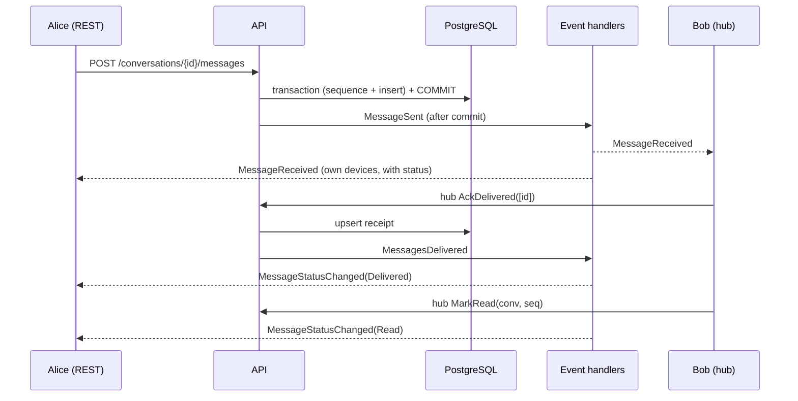

# 6. Realtime (SignalR)

Location: `server/src/Messenger.Api/Realtime` (hub, presence, notifier), `server/src/Messenger.Application/Realtime` (post-commit handlers), `client/src/realtime/hub.ts` (client).

## Principle
**REST changes state; the hub carries events and ephemeral signals.** Every message, edit, delete or status is first committed through a REST command; only then is it pushed. Clients can always recover over REST, so a missed event is never fatal.

## Connection
- URL: `/hubs/chat`. Authenticated with the JWT in `?access_token=` (WebSocket cannot send headers). The query string of hub requests is never logged.
- `CloseOnAuthenticationExpiration = true`: the server closes the socket when the access token expires; the client reconnects with a fresh token (`accessTokenFactory` refreshes proactively).
- `IUserIdProvider` (`SubUserIdProvider`) uses the JWT `sub`, so `Clients.User(id)` reaches every device of a user.
- Max receive message size 32 KB; detailed errors are off.

## Client → server (hub methods)

| Method | Purpose | Notes |
|---|---|---|
| `AckDelivered(Guid[] messageIds)` → `int` | Mark messages delivered | Idempotent; returns how many were newly marked; ≤ 200 ids |
| `MarkRead(conversationId, upToSequence)` → `long` | Mark read up to a sequence | Set-based; only called when the chat is open and the tab visible |
| `Typing(conversationId)` | Typing indicator | Throttled to once per 2 s per connection; delivered to *others* in the conversation group |
| `OpenConversation(id)` / `CloseConversation(id)` | Join/leave group `conv:{id}` | Membership is checked on the server |
| `WatchPresence(Guid[] userIds)` → `PresenceDto[]` | Subscribe to presence | ≤ 100 ids; only users who share a conversation with the caller; joins groups `presence:{userId}` |

All hub methods go through MediatR (`CheckMembershipQuery`, `AckDeliveredCommand`, …) so the same authorization behaviors apply as for REST. Failures surface as `HubException`.

## Server → client (events)

| Event | Payload | Audience |
|---|---|---|
| `MessageReceived` | `MessageDto` (viewer-specific) | every participant who can see the message, all devices (the sender's own projection includes `status`) |
| `MessageUpdated` | `MessageDto` | same |
| `MessageDeleted` | `{conversationId, messageId, sequence, updatedSequence}` | same |
| `MessageStatusChanged` | `{conversationId, messageId, status}` | the author only |
| `ConversationUpdated` | `{conversationId}` | current members plus users just removed |
| `ConversationRead` | `{conversationId, lastReadSequence}` | the reader's other devices |
| `SummaryCompleted` | `{conversationId, jobId, status: "ready"\|"failed", summary?, errorCode?}` | every device of the user who asked for the summary; `GET conversations/{id}/summary/{jobId}` is the fallback |
| `Typing` | `{conversationId, userId}` | group `conv:{id}` except the sender |
| `PresenceChanged` | `{userId, online, lastSeenAt?}` | group `presence:{userId}` |

Messages and statuses are routed **per user** (not via groups) because that is reliable for multi-device and needs no group bookkeeping when membership changes. Groups are only a routing cache for typing and presence; they are never the source of truth.

## Server-side flow

Statuses seen by the author: `Sent` → `Delivered` (all recipients acknowledged) → `Read` (all recipients read). Receipts are created lazily.

## Presence (`PresenceTracker`)
- In-memory, single instance: `Dictionary<userId, set of connectionIds>`.
- First connection → `online`. Last disconnect starts a grace timer (`Presence:GraceSeconds`, default 7 s) so a page reload does not flicker; if nobody reconnects, `users.last_seen_at` is written **once** and `offline` is broadcast.
- `IsOnline(userId)` also counts users in the grace period.
- Used for conversation lists, profiles and to decide whether to send Web Push.
- Scaling out would need a Redis backplane and shared presence.

## Resync after reconnect (client)
1. Invalidate `GET /conversations` (snapshot, unread counts).
2. Re-watch presence and re-open open conversations.
3. For each open chat: `GET messages?after=<max updatedSequence>` repeatedly (new **and** edited/deleted), merge idempotently, acknowledge delivery.
4. `GET statuses?fromSequence=0` to refresh ticks.

## Testing
`RealtimeTests` uses two real `HubConnection`s against the test server: send → receive → ack → status, typing, presence grace and contact-only visibility, resync via REST, anonymous connection rejected.
