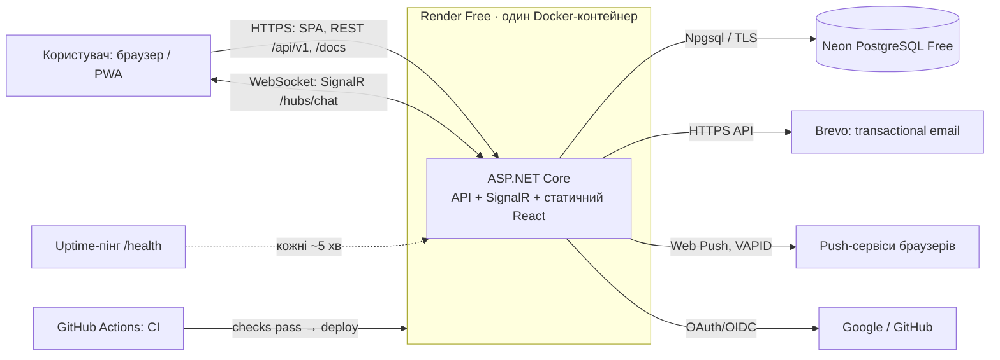
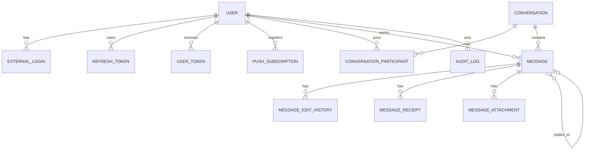
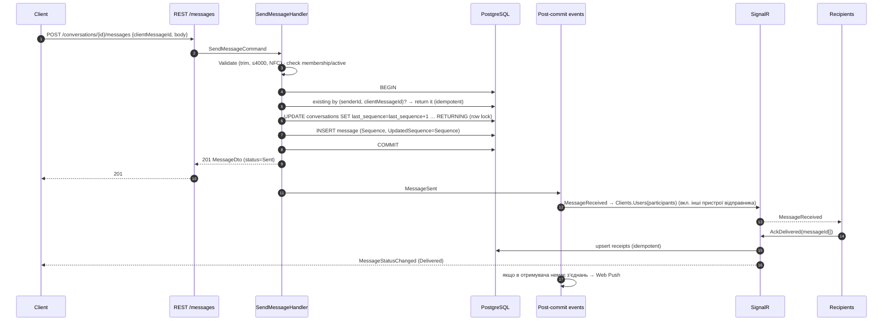

# Архітектура, деплой і план реалізації — Messenger (Lab 01 + Lab 21)

> Версія 1.0 · 29.09.2026 · Документ 2 із 2 (вимоги — `01-requirements-analysis.md`)
> ID вимог (AUTH-…, MSG-…, P-…, OQ-…) посилаються на файл 1.
> Ціни/ліміти безкоштовних тарифів **перевірені 29.09.2026** і змінюються часто — перед стартом звірте з офіційними сторінками.

---

## 1. Ключові рішення (ADR-реєстр)

Усі ваші рішення з підготовчого списку **приймаються**, окрім позначених нижче. Нових рішень мінімум — вони продиктовані вимогою «повністю безкоштовний деплой» та коректністю.

| # | Рішення | Ваш план | Пропозиція | Чому |
|---|---|---|---|---|
| D-01 | Платформа | .NET / ASP.NET Core | **Приймаємо** (.NET 10 LTS; підійде й 9) | — |
| D-02 | Архітектура | Clean + CQRS + MediatR | **Приймаємо**, але медіатор — `Mediator` (MIT, source generator) або MediatR 12.x | MediatR v13+ — dual license (P-04) |
| D-03 | БД | EF Core + SQL Server | 🔁 **EF Core + PostgreSQL (Neon)**; SQL Server — варіант B | Безкоштовного постійного SQL Server майже немає (P-02) |
| D-04 | Репозиторії + UoW | Так | **Приймаємо** для команд; запити — прямі проєкції | P-16 |
| D-05 | Domain Events | Так | **Приймаємо**, диспатч **після commit** | P-05 |
| D-06 | Realtime | SignalR, один `ChatHub`, Groups | **Приймаємо**; **команди — через REST, події — через hub** (hub-методи лише `Typing`, `AckDelivered`, `MarkRead`, `WatchPresence`) | Ідемпотентність, `curl`-тестованість, вимога Lab 21 |
| D-07 | Auth | Власний акаунт + OAuth | **Приймаємо** (власна реалізація, не ASP.NET Identity) | Лаба вимагає вміти пояснити «пароль → хеш → JWT → user»; менше «магії» |
| D-08 | Refresh-cookie | HttpOnly+Secure | + **SameSite=Strict**, path `/api/v1/auth`, same-origin | P-01 |
| D-09 | Sequence | «серверний Sequence» | **Per-conversation лічильник** + `UpdatedSequence` | P-03, P-11 |
| D-10 | Вотермарки | `ChatResetAt`, `JoinedAt` | Зберігати як `ClearedUpToSequence`, `VisibleFromSequence` (+ час для UI) | P-06 |
| D-11 | Frontend | React + Vercel | 🔁 **React (Vite+TS), що віддається з того ж контейнера**; Vercel — варіант B | P-01 |
| D-12 | Backend hosting | «ще проєктувати» | **Render (Docker, free) + Neon (Postgres) + Brevo (email)** | Розд. 12 |
| D-13 | Вкладення | TBD | **Лише метадані** зараз | OQ-09 |
| D-14 | Пошук | — | **pg_trgm + ILIKE** з фільтром видимості | MSG-07 |
| D-15 | Тести/CI | — | xUnit + Testcontainers + GitHub Actions | OPS-02/03 |
| D-16 | Логи | — | Serilog (JSON) | API-11 |
| D-17 | OpenAPI | — | `Microsoft.AspNetCore.OpenApi` + **Scalar** на `/docs` | Swashbuckle більше не в шаблонах .NET 9+ |
| D-18 | Rate limiting | — | Вбудований `Microsoft.AspNetCore.RateLimiting` | API-05 |
| D-19 | Хеш пароля | — | **BCrypt.Net-Next**, `EnhancedHashPassword`, work factor 11–12 (за замірами на free-CPU) за абстракцією `IPasswordHasher` | AUTH-02 |

---

## 2. Контекст системи та топологія



Один деплой-артефакт (контейнер) = один origin = немає CORS-проблем, cookie працює, WebSocket без проксі-обмежень.

---

## 3. Структура рішення (Clean Architecture)

```txt
messenger/
  README.md
  render.yaml                      # Render Blueprint
  Dockerfile                       # multi-stage: node build → dotnet publish → runtime
  docker-compose.yml               # локально: postgres + mailpit
  .env.example
  .github/workflows/ci.yml
  docs/                            # діаграми, скріни, requests.http / bruno-колекція
  client/                          # React + Vite + TypeScript
  server/
    Messenger.sln
    src/
      Messenger.Domain/            # сутності, value objects, domain events, Result — БЕЗ залежностей
      Messenger.Application/       # CQRS: Commands/Queries/Handlers, Behaviors, Validators, DTO, інтерфейси портів
      Messenger.Infrastructure/    # EF Core, репозиторії, UoW, JWT/BCrypt, Email, WebPush, OAuth, Clock
      Messenger.Api/               # Controllers, ChatHub, middleware, DI-композиція, OpenAPI, wwwroot (SPA)
    tests/
      Messenger.Domain.Tests/
      Messenger.Application.Tests/
      Messenger.Api.IntegrationTests/   # WebApplicationFactory + Testcontainers + SignalR client
      Messenger.Architecture.Tests/     # NetArchTest: правила залежностей
```

**Правило залежностей:** `Domain ← Application ← Infrastructure`, `Api` → `Application` + `Infrastructure` (composition root). Domain не знає про EF/ASP.NET. Application оголошує *порти* (`IMessageRepository`, `IUnitOfWork`, `IEmailSender`, `IPushSender`, `IRealtimeNotifier`, `IPasswordHasher`, `ITokenService`, `IClock`, `ICurrentUser`, `IApplicationDbContext` для read-side); Infrastructure/Api їх реалізують. `SignalRRealtimeNotifier` (на `IHubContext<ChatHub>`) живе в `Api`.

---

## 4. Доменна модель



### 4.1 Сутності та ключові поля

| Сутність | Поля (скорочено) | Інваріанти / індекси |
|---|---|---|
| **User** | `Id` (GUID v7), `Email`, `EmailNormalized`, `EmailConfirmed`, `PasswordHash?`, `Username`, `UsernameNormalized`, `DisplayName`, `Role` (User/Admin), `Status` (Active/Suspended/Deleted), `CreatedAt`, `DeletedAt?`, `LastSeenAt?` | **Унікальні часткові індекси** `UsernameNormalized` і `EmailNormalized` `WHERE Status <> Deleted` → username звільняється після видалення |
| **ExternalLogin** | `UserId`, `Provider`, `ProviderUserId` | Унікально `(Provider, ProviderUserId)` |
| **UserToken** | `Id`, `UserId`, `Type` (EmailVerify/PasswordReset), `TokenHash`, `ExpiresAt`, `UsedAt?` | У БД лише SHA-256 хеш; одноразовий |
| **RefreshToken** | `Id`, `UserId`, `FamilyId`, `TokenHash`, `CreatedAt`, `ExpiresAt`, `RevokedAt?`, `ReplacedByTokenId?`, `UserAgent`, `Ip` | Індекс по `TokenHash`, `FamilyId`; сесія = family |
| **Conversation** | `Id`, `Type` (Direct/Group), `DirectKey?`, `Title?`, `CreatedById`, `CreatedAt`, `LastSequence`, `LastMessageAt`, `DeletedAt?` | Унікальний `DirectKey` (`"{minId}:{maxId}"`) `WHERE DirectKey IS NOT NULL` (P-13) |
| **ConversationParticipant** | PK `(ConversationId, UserId)`, `Role` (Owner/Admin/Member), `JoinedAt`, `VisibleFromSequence`, `ClearedUpToSequence`, `LastReadSequence`, `LeftAt?` | Видимі повідомлення: `Sequence > max(VisibleFromSequence-1, ClearedUpToSequence)` |
| **Message** | `Id`, `ConversationId`, `Sequence`, `UpdatedSequence`, `SenderId`, `SenderUsernameSnapshot`, `SenderDisplayNameSnapshot`, `Body`, `ReplyToMessageId?`, `ClientMessageId`, `CreatedAt`, `EditedAt?`, `DeletedAt?` | Унікально `(ConversationId, Sequence)` і `(SenderId, ClientMessageId)`; індекс `(ConversationId, Sequence DESC)`; GIN trigram по `Body` |
| **MessageEditHistory** | `Id`, `MessageId`, `PreviousBody`, `EditedAt` | Бачить лише автор; чиститься при delete |
| **MessageReceipt** | PK `(MessageId, UserId)`, `DeliveredAt`, `ReadAt?` | Рядки створюються **ліниво** при ack (не при відправці) — «не доставлено» = учасник без рядка |
| **MessageAttachment** | `Id`, `MessageId`, `FileName`, `SizeBytes`, `ContentType`, `StorageKey?` | Зараз лише метадані |
| **PushSubscription** | `Id`, `UserId`, `Endpoint` (unique), `P256dh`, `Auth`, `CreatedAt`, `LastSuccessAt` | Видаляти при 404/410 |
| **AuditLog** | `Id`, `ActorUserId`, `Action`, `EntityType`, `EntityId`, `DataJson`, `Ip`, `CreatedAt` | Append-only (C) |

### 4.2 Domain Events

`UserRegistered`, `EmailVerified`, `PasswordChanged`, `PasswordReset`, `UserDeleted`, `ConversationCreated`, `ParticipantAdded`, `ParticipantRemoved`, `MessageSent`, `MessageEdited`, `MessageDeleted`, `MessagesDelivered`, `MessagesRead`.

Агрегати збирають події у `DomainEvents`; `SaveChangesInterceptor` після **успішного** commit публікує їх через медіатор → handlers: `SignalRRealtimeNotifier`, `WebPushOnMessageSent`, `SendVerificationEmail`.

---

## 5. Application-шар: CQRS

**Pipeline behaviors (порядок):** `Logging → Validation (FluentValidation → 422) → Authorization (перевірка членства/ролі) → Transaction (для Commands) → Handler`.

**Result pattern:** handlers повертають `Result<T>` із типізованою помилкою (`NotFound`, `Forbidden`, `Validation`, `Conflict`); контролер мапить у ProblemDetails.

| Модуль | Commands | Queries |
|---|---|---|
| Auth | Register, VerifyEmail, ResendVerification, Login, RefreshToken, Logout, ForgotPassword, ResetPassword, ChangePassword, ExternalLoginCallback, CompleteExternalProfile, RevokeSession | ListSessions |
| Users | UpdateProfile, ChangeUsername, DeleteAccount, SuspendUser (admin) | GetMe, GetUser, SearchUsers, AdminListUsers |
| Conversations | SendDirectMessage (get-or-create), CreateGroup, RenameGroup, AddMembers, RemoveMember, ChangeMemberRole, LeaveConversation, ClearDirectChat, DeleteGroup | ListConversations, GetConversation, GetDirectByPeer, ListMembers |
| Messages | SendMessage, EditMessage, DeleteMessage, AckDelivered, MarkRead | GetMessages (cursor), GetMessageHistory, GetMessageInfo, GetStatuses, SearchMessages |
| Presence/Push | SubscribePush, UnsubscribePush | GetPresence |

### 5.1 Алгоритм відправки повідомлення (серце системи)



**Алокація Sequence (PostgreSQL):**

```sql
UPDATE conversations
SET last_sequence = last_sequence + 1, last_message_at = @now
WHERE id = @conversationId AND deleted_at IS NULL
RETURNING last_sequence AS "Value";   -- EF: Database.SqlQuery<long>(...)
```

Рядок розмови блокується до commit → порядок commit’ів = порядок `Sequence` → `after=N` ніколи не пропускає повідомлення. Для SQL Server: `UPDATE … OUTPUT inserted.LastSequence`.

**Edit/Delete** беруть новий номер з того ж лічильника і пишуть його в `Message.UpdatedSequence` → resync (`afterSequence`) бачить і нові, і змінені повідомлення (P-11).

**Read:** `MarkRead(conversationId, upToSequence)` → set-based: `LastReadSequence = max(old, upTo)` + масова вставка/оновлення `MessageReceipts` для чужих повідомлень у діапазоні (`DeliveredAt` ставиться, якщо ще нема).

**Агрегований статус для автора (P-07):** `Read`, якщо у *всіх* одержувачів є `ReadAt`; `Delivered`, якщо у всіх є `DeliveredAt`; інакше `Sent`.

**Unread:** кількість повідомлень із `Sequence > LastReadSequence`, вище вотермарок видимості, `SenderId ≠ me`, не видалених — один згрупований запит на список розмов.

---

## 6. Автентифікація та безпека

### 6.1 Токени й сесії

| Артефакт | Значення |
|---|---|
| Access token | JWT HS256 (секрет ≥ 256 біт з env), TTL **10–15 хв**, claims: `sub`, `sid`, `role`, `jti`, `exp`; зберігається **лише в пам’яті JS** |
| Refresh token | 256-біт CSPRNG, у БД — SHA-256 хеш; TTL 14–30 днів |
| Cookie | `rt`; `HttpOnly; Secure; SameSite=Strict; Path=/api/v1/auth` |
| Ротація | Кожен `/auth/refresh` видає новий refresh, старий → `ReplacedByTokenId`; **reuse detection** → відкликати всю family; grace window 10–30 с для паралельних вкладок (P-09) |
| CSRF для refresh | Перевірка `Origin`/`Sec-Fetch-Site` + обов’язковий заголовок `X-Requested-With` |
| Хеш пароля | `BCrypt.EnhancedHashPassword` (SHA-384 pre-hash обходить ліміт 72 байти) |
| Одноразові токени (verify/reset) | Випадкові, у БД хеш, `UsedAt`, TTL; reset → відкликає **всі** refresh-сесії |

```mermaid
sequenceDiagram
  participant B as Browser (SPA)
  participant API as /api/v1/auth
  participant DB as RefreshTokens
  B->>API: POST /auth/login {email,password}
  API->>API: BCrypt.Verify · email verified? · lockout?
  API->>DB: create family + token(hash)
  API-->>B: 200 {accessToken} + Set-Cookie rt=…(HttpOnly)
  Note over B: access у пам’яті; на reload → /auth/refresh
  B->>API: POST /auth/refresh (cookie)
  API->>DB: find by hash
  alt активний
    API->>DB: revoke old, insert new (ReplacedBy)
    API-->>B: 200 {accessToken} + нова cookie
  else вже ротований (reuse) поза grace
    API->>DB: revoke whole family
    API-->>B: 401 → SPA показує логін
  end
```

### 6.2 SignalR та автентифікація

- Клієнт: `accessTokenFactory` → токен іде в `?access_token=` (обмеження WebSocket). Serilog **виключає query** для `/hubs/*` (P-10).
- Сервер: `CloseOnAuthenticationExpiration = true`; при оновленні access-токена SPA перепідключає hub (плавно).
- `IUserIdProvider` бере `sub` → `Clients.User(id)` / `Clients.Users(ids)` доставляє на **всі пристрої**.

### 6.3 OAuth/OIDC

Backend-driven Authorization Code: `GET /auth/external/{provider}/login` → провайдер → callback (`/signin-google`, `/signin-github`) → знайти/створити користувача за `(provider, sub)` (політика P-18) → встановити refresh-cookie → редірект на SPA `/auth/callback` → SPA викликає `/auth/refresh` й отримує access. Новий OAuth-користувач без username → екран онбордингу (`POST /auth/external/complete-profile`).

### 6.4 Матриця авторизації

| Дія | Автор повідомлення | Учасник | Group Admin | Group Owner | System Admin |
|---|---|---|---|---|---|
| Читати повідомлення розмови | ✅ | ✅ (з вотермарками) | ✅ | ✅ | ❌ |
| Редагувати повідомлення (≤ 48 год) | ✅ | ❌ | ❌ | ❌ | ❌ |
| Видаляти повідомлення | ✅ | ❌ | ❌* | ❌* | ❌ |
| Історія редагувань / Message Info | ✅ (лише автор) | ❌ | ❌ | ❌ | ❌ |
| Додавати/видаляти учасників | — | ❌ | ✅ | ✅ | ❌ |
| Призначати адміна групи | — | ❌ | ❌ | ✅ | ❌ |
| Видалити групу | — | ❌ | ❌ | ✅ | ❌ |
| Блокувати користувача, audit log | — | ❌ | ❌ | ❌ | ✅ |

\* Значення за замовчуванням (OQ-07); змінюється однією політикою в Application.

---

## 7. Realtime-дизайн (SignalR `ChatHub`, `/hubs/chat`)

**Принцип:** REST змінює стан (єдине джерело істини), hub — низьколатентні події та ephemeral-сигнали.

| Напрям | Метод/подія | Payload | Примітка |
|---|---|---|---|
| C→S | `AckDelivered(messageIds[])` | ids | Ідемпотентно (STS-02) |
| C→S | `MarkRead(conversationId, upToSequence)` | — | Лише коли чат відкритий і вкладка активна |
| C→S | `Typing(conversationId)` | — | Клієнт throttle ≤ 1/2–3 с; серверний ліміт per-connection |
| C→S | `OpenConversation(id)` / `CloseConversation(id)` | — | Додає/прибирає з group `conv:{id}` після перевірки членства |
| C→S | `WatchPresence(userIds[])` | ≤ 100 id | Додає у groups `presence:{userId}` лише для тих, з ким є спільна розмова (PRS-04) |
| S→C | `MessageReceived` | `MessageDto` | Через `Clients.Users(participants)` |
| S→C | `MessageUpdated` / `MessageDeleted` | dto / id+sequence | Edit / tombstone |
| S→C | `MessageStatusChanged` | `messageId, status, by?` | Для автора |
| S→C | `ConversationUpdated` | dto | Нова група, зміна складу, повернення чату у список |
| S→C | `Typing` | `conversationId, userId` | У group `conv:{id}` крім відправника |
| S→C | `PresenceChanged` | `userId, online, lastSeenAt?` | У group `presence:{userId}` |

**Groups vs SQL:** SignalR-групи — це *кеш маршрутизації в пам’яті*, не джерело істини (ваше рішення «окремо від SQL Conversation» збережено). Членство перевіряється на сервері при кожному `Open/Watch`; клієнт не обирає групи довільно. Доставка повідомлень/статусів — за користувачем (`Clients.Users`), бо це надійніше для мультипристроїв і не потребує синхронізації груп при змінах складу.

**Presence:** `IPresenceTracker` (singleton, `ConcurrentDictionary<UserId, HashSet<ConnectionId>>`). Перше з’єднання → `online`; останнє відключення → grace 5–10 с → `LastSeenAt` у БД (**один запис на відключення**) → `offline`.

**Reconnect/resync (STS-08):**
1. `GET /conversations` — снепшот (`lastSequence`, unread, last message).
2. Для відкритої розмови — `GET /conversations/{id}/messages?afterSequence=<lastKnown>` (нові **і** змінені).
3. `GET /conversations/{id}/statuses?fromSequence=` — актуальні статуси власних повідомлень.
4. `AckDelivered` для отриманого; `MarkRead`, якщо чат видимий.

**Масштабування:** in-memory presence/groups = **один інстанс**. Для N інстансів: Redis backplane (SignalR) + presence у Redis. Це прямий відповідь на питання рефлексії «1M users» (розд. 15).

---

## 8. REST API (`/api/v1`)

Конвенції: JSON camelCase, ISO-8601 UTC, помилки — ProblemDetails (`type`, `title`, `status`, `detail`, `traceId`, `errors{}`). Пагінація: cursor `?before=&after=&limit≤50` (повідомлення) та `?limit=&offset=` → `{items,total,next}` (списки).

**Auth**

| Метод | Шлях | Опис | Коди |
|---|---|---|---|
| POST | `/auth/register` | Реєстрація (нейтральна відповідь) | 202/422/429 |
| POST | `/auth/verify-email` | Підтвердження email | 204/400/410 |
| POST | `/auth/resend-verification` | Повторний лист | 202/429 |
| POST | `/auth/login` | access + refresh-cookie | 200/401/403(не підтверджено)/429 |
| POST | `/auth/refresh` | Ротація | 200/401 |
| POST | `/auth/logout` | Відкликати поточну | 204 |
| POST | `/auth/forgot-password` · `/auth/reset-password` | Скидання | 202 · 204/400/410 |
| POST | `/auth/change-password` | Інші сесії відкликаються | 204/401/422 |
| GET | `/auth/external/{provider}/login` · `/callback` | OAuth | 302 |
| POST | `/auth/external/complete-profile` | Обрати username | 200/409/422 |
| GET/DELETE | `/auth/sessions` · `/auth/sessions/{id}` | Сесії | 200 · 204 |

**Users**

| Метод | Шлях | Опис |
|---|---|---|
| GET | `/users/me` | Профіль |
| PATCH | `/users/me` | displayName |
| PUT | `/users/me/username` | Зміна username (409 якщо зайнятий) |
| DELETE | `/users/me` | Видалення акаунта (потрібен пароль) → 204 |
| GET | `/users?q=&limit=&offset=` | Пошук користувачів |
| GET | `/users/{id}` | Публічний профіль |

**Conversations & members**

| Метод | Шлях | Опис |
|---|---|---|
| GET | `/conversations` | Список (unread, preview, presence) |
| GET | `/conversations/{id}` | Деталі |
| GET | `/conversations/direct/{peerUserId}` | Існуюча або 404 (клієнт показує «чернетку») |
| POST | `/conversations/direct/{peerUserId}/messages` | **Get-or-create + перше повідомлення** → 201 |
| POST | `/conversations/groups` | Створення з учасниками → 201 |
| PATCH | `/conversations/{id}` | Назва групи |
| POST | `/conversations/{id}/clear` | Personal: ChatReset для мене → 204 |
| POST | `/conversations/{id}/leave` | Вийти з групи → 204 |
| DELETE | `/conversations/{id}` | Видалити групу (Owner) → 204 |
| GET/POST | `/conversations/{id}/members` | Список / додати |
| PATCH/DELETE | `/conversations/{id}/members/{userId}` | Роль / видалити |

**Messages**

| Метод | Шлях | Опис |
|---|---|---|
| GET | `/conversations/{id}/messages?before=&after=&limit=` | Історія (cursor, ≤ 50) |
| POST | `/conversations/{id}/messages` | Відправка (ідемпотентна) → 201 |
| PATCH | `/messages/{id}` | Редагувати (≤ 48 год) → 200/403/409/422 |
| DELETE | `/messages/{id}` | Tombstone → 204 |
| GET | `/messages/{id}/history` | Історія редагувань (автор) |
| GET | `/messages/{id}/info` | Delivery/Read по учасниках (автор) |
| POST | `/conversations/{id}/read` | REST-fallback для `MarkRead` |
| GET | `/conversations/{id}/statuses?fromSequence=` | Статуси для resync |
| GET | `/search/messages?q=&conversationId=&limit=&offset=` | Пошук |

**Push · Admin · Ops**

| Метод | Шлях | Опис |
|---|---|---|
| POST/DELETE | `/push/subscriptions` | Підписка / відписка |
| GET | `/admin/users?limit=&offset=&q=` | Admin (limit/offset+total) |
| POST | `/admin/users/{id}/suspend` · `/unsuspend` | Блокування |
| GET | `/admin/audit?limit=&offset=` | Audit log |
| GET | `/health` · `/health/ready` | Liveness / readiness (без auth) |
| GET | `/docs` · `/openapi/v1.json` | Scalar UI / OpenAPI |

---

## 9. Дані, індекси, пошук, «How data is stored»

- **Міграції:** EF Core з першого дня; при старті застосовуються з `pg_advisory_lock`, щоб два інстанси не мігрували одночасно.
- **Транзакції:** `TransactionBehavior` + EF `ExecutionStrategy` (retry на transient-збої Neon: cold start/розрив з’єднання).
- **Пошук (Postgres):**

```sql
CREATE EXTENSION IF NOT EXISTS pg_trgm;
CREATE INDEX ix_messages_body_trgm ON messages USING gin (body gin_trgm_ops) WHERE deleted_at IS NULL;
-- запит: body ILIKE '%' || @q || '%'  ·  JOIN participants  ·  sequence > видимість  ·  deleted_at IS NULL
```
Фільтр видимості (P-17) — частина **кожного** пошукового запиту й покритий тестом.
- **Розмір:** Neon Free — 0.5 GB на проєкт; seed для демо тримайте ≤ кількох тисяч повідомлень.
- **Чернетка абзацу для README («How data is stored»):**
  > Дані зберігаються в PostgreSQL. Кожне повідомлення записується в транзакції: спершу з лічильника розмови атомарно береться наступний `Sequence` (це гарантує порядок), потім вставляється рядок повідомлення, і лише після commit іде розсилка через SignalR. Тому повідомлення не губиться при падінні процесу, а повторна відправка з тим самим `clientMessageId` не створює дублікатів. Видалені сутності позначаються `DeletedAt` (soft delete), тіла видалених повідомлень обнуляються. Усі час — UTC.

---

## 10. Наскрізні аспекти

| Тема | Рішення |
|---|---|
| Валідація | FluentValidation у pipeline → 422 `ValidationProblemDetails`; нормалізація NFC, trim, заборона control-символів |
| Помилки | Глобальний `IExceptionHandler` → ProblemDetails; 500/503 без внутрішніх деталей, з `traceId` |
| Rate limiting | `global`: 60/хв/IP (fixed window) · `auth`: 10/хв/IP на login/register/forgot/resend · `send-message`: token bucket per-user (напр. 30/хв, burst 10) → **429 + `Retry-After`**. `UseForwardedHeaders` (P-20) |
| Logging | Serilog Compact JSON: method, path, status, `userId`, duration, `traceId`; redaction: паролі, токени, `Authorization`, cookie, тіла повідомлень; query `/hubs/*` не логується |
| Health | `/health` — процес живий; `/health/ready` — `SELECT 1` до БД. Render health check → `/health` |
| Конфіг | `IOptions` + env (`ConnectionStrings__Default`, `Jwt__Secret`…); `.env.example` у репо; gitleaks у CI |
| CORS | У prod (same-origin) вимкнений; у dev — Vite proxy, тож теж не потрібен; для варіанта B — allow-list origin + credentials |
| Security headers | CSP (self + wss), `X-Content-Type-Options`, `Referrer-Policy`, HSTS |
| Email | `IEmailSender`: Console/File у dev, **Mailpit** у docker-compose, **Brevo** у prod |
| Web Push | `Lib.Net.Http.WebPush` / `WebPush` + VAPID; service worker у клієнті; на iOS push працює лише для встановленого PWA |
| Час | `IClock` (тестованість), UTC скрізь |

---

## 11. Фронтенд (React)

| Питання | Рішення |
|---|---|
| Стек | Vite + React + TypeScript, React Router, TanStack Query (кеш REST), невеликий store (Zustand) для realtime/presence, `@microsoft/signalr` |
| Auth | Access у пам’яті; bootstrap → `POST /auth/refresh`; interceptor: 401 → один спільний refresh → повтор |
| Синхронізація | Realtime-події **оновлюють кеш TanStack Query** (`setQueryData`); на reconnect — invalidate + resync (розд. 7) |
| Історія | Infinite scroll вгору (cursor `before`), віртуалізація списку (`react-virtuoso`) |
| Optimistic UI | Повідомлення з `clientMessageId` зі статусом «надсилається/failed/retry»; підміна на серверне за `clientMessageId` |
| Екрани | Login/Register/Verify/Reset · Chats (список + чат) · New chat (пошук користувачів) · Group create/settings · Message Info · Search · Profile/Sessions · Admin |
| PWA | Manifest + service worker (push, offline-shell) |
| Dev | `vite.config`: proxy `/api` і `/hubs` (ws: true) → `https://localhost:5001` |
| Prod | `npm run build` → `dist` копіюється у `wwwroot` образу; `MapFallbackToFile("index.html")` |
| Тема | Токени CSS-змінних → «Make it yours» (наприклад IRC-90s) — змінюється лише тема |

---

## 12. Безкоштовний деплой

### 12.1 Стан безкоштовних тарифів (перевірено 29.09.2026)

| Платформа | Що безкоштовно | Підводні камені | Картка |
|---|---|---|---|
| **Render** (web, Docker) | 750 інстанс-годин/міс; засинає після 15 хв неактивності | ≈50 с cold start; free-bandwidth 5 ГБ/міс (з квітня 2026); ~0.1 CPU / 512 МБ RAM | Зазвичай ні (може попросити — перевірте) |
| **Neon** (PostgreSQL) | 0.5 ГБ, 100 CU-год/міс на проєкт, scale-to-zero через 5 хв | Вичерпання CU-годин → compute призупиняється до наступного періоду; дані не видаляються | Ні |
| **Azure SQL free offer** | 100 000 vCore-с/міс і 32 ГБ на БД; безстроково | Потрібна Azure-підписка; обери **«Auto-pause until next month»** (інакше — білінг понад ліміт); відкриті з’єднання (SSMS) з’їдають ліміт | **Так** |
| **Azure App Service F1** | Безкоштовно | 60 CPU-хв/добу; без Always On (вивантажується ≈20 хв); лише `*.azurewebsites.net` | **Так** |
| **Brevo** (email) | 300 листів/день | Логотип Brevo в листах free-плану | Ні |
| Koyeb | 1 free web service | З лютого 2026 — картка з $29 hold | **Так** |
| Fly.io | — | Безкоштовні allowance прибрано (trial: 2 machine-години / 7 днів) | **Так** |
| Railway | $1 кредиту/міс після 30-денного trial | Кілька годин роботи на місяць | — |
| Oracle Cloud VM | Always Free Arm: 2 OCPU / 12 ГБ (зменшено у червні 2026) | Картка; простоюючі інстанси можуть бути reclaimed | **Так** |

### 12.2 Рекомендована схема — **План A** (без картки)

**Render (Docker) + Neon (Postgres) + Brevo (email) + GitHub Actions.** Один URL для SPA, API, `/docs`.

#### Крок 0 — Репозиторій і секрети
1. GitHub-репо `messenger` (моно-репо: `client/`, `server/`).
2. Згенеруйте секрети (локально, **не комітьте**):
   - `openssl rand -base64 48` → `JWT__SECRET`
   - `npx web-push generate-vapid-keys` → `VAPID__PUBLICKEY`, `VAPID__PRIVATEKEY`
3. Додайте `.env`/`appsettings.*.local.json` у `.gitignore`; створіть `.env.example`.

#### Крок 1 — Neon
1. neon.com → Sign up → New Project; регіон **EU (Frankfurt)**, той самий регіон, що й Render.
2. Скопіюйте connection string. Для Npgsql формат:
   `Host=<endpoint>.neon.tech;Database=neondb;Username=<user>;Password=<pwd>;SSL Mode=Require;Maximum Pool Size=10;Timeout=30`
3. Використовуйте **прямий (не pooler) хост**, бо Npgsql має власний пул; увімкніть в EF `EnableRetryOnFailure()` — перший запит після паузи Neon повільніший.
4. **Не** запускайте фонові задачі, що б’ють у БД щохвилини (з’їдять CU-години). Cleanup прострочених токенів — раз на добу або при старті.
5. У БД виконайте `CREATE EXTENSION pg_trgm;` (або в першій міграції).

#### Крок 2 — Email (Brevo)
1. brevo.com → free план → **Senders** → підтвердіть свою адресу відправника.
2. **SMTP & API → API keys** → створіть ключ → `EMAIL__BREVOAPIKEY`, `EMAIL__FROM`.
3. Ліміт 300/день достатньо для лаби. Локально користуйтесь Mailpit, а не Brevo.

#### Крок 3 — OAuth (опційно)
- Google Cloud Console → OAuth consent + credentials: redirect URI `https://<app>.onrender.com/signin-google`.
- GitHub → Settings → Developer settings → OAuth Apps: callback `https://<app>.onrender.com/signin-github`.
- Ключі → `AUTHENTICATION__GOOGLE__CLIENTID/SECRET`, `…GITHUB__…`.

#### Крок 4 — Dockerfile (у корені)

```dockerfile
# syntax=docker/dockerfile:1
FROM node:22-alpine AS client
WORKDIR /client
COPY client/package*.json ./
RUN npm ci
COPY client/ .
RUN npm run build

FROM mcr.microsoft.com/dotnet/sdk:10.0 AS build
WORKDIR /src
COPY server/ .
RUN dotnet restore src/Messenger.Api/Messenger.Api.csproj
RUN dotnet publish src/Messenger.Api/Messenger.Api.csproj -c Release -o /app --no-restore

FROM mcr.microsoft.com/dotnet/aspnet:10.0
WORKDIR /app
COPY --from=build /app .
COPY --from=client /client/dist ./wwwroot
ENV ASPNETCORE_ENVIRONMENT=Production
EXPOSE 10000
# Render передає порт у $PORT
CMD ["sh", "-c", "ASPNETCORE_URLS=http://0.0.0.0:${PORT:-10000} dotnet Messenger.Api.dll"]
```

#### Крок 5 — Render
1. render.com → Sign up через GitHub → **New → Web Service** → оберіть репо.
2. **Runtime: Docker**, Dockerfile path `./Dockerfile`, **Instance type: Free**, регіон Frankfurt.
3. **Health Check Path:** `/health`.
4. **Environment:** додайте змінні з таблиці 12.4.
5. Деплой: Auto-Deploy → **After CI checks pass** (щоб не деплоїти червоний білд).
6. Після старту відкрийте `https://<app>.onrender.com/docs` та `/health`.

(Альтернатива — Blueprint `render.yaml`; перевірте актуальний синтаксис у документації Render.)

```yaml
services:
  - type: web
    name: messenger
    runtime: docker
    plan: free
    region: frankfurt
    healthCheckPath: /health
    autoDeployTrigger: checksPass
    envVars:
      - key: ASPNETCORE_ENVIRONMENT
        value: Production
      - key: ConnectionStrings__Default
        sync: false
      - key: Jwt__Secret
        sync: false
```

#### Крок 6 — CI (`.github/workflows/ci.yml`)

```yaml
name: ci
on: [push, pull_request]
jobs:
  server:
    runs-on: ubuntu-latest
    steps:
      - uses: actions/checkout@v4
      - uses: actions/setup-dotnet@v4
        with: { dotnet-version: 10.0.x }
      - run: dotnet build server/Messenger.sln -c Release
      - run: dotnet test server/Messenger.sln -c Release --no-build   # Testcontainers: Docker є на ubuntu-latest
  client:
    runs-on: ubuntu-latest
    steps:
      - uses: actions/checkout@v4
      - uses: actions/setup-node@v4
        with: { node-version: 22, cache: npm, cache-dependency-path: client/package-lock.json }
      - run: npm ci && npm run lint && npm test -- --run && npm run build
        working-directory: client
  secrets:
    runs-on: ubuntu-latest
    steps:
      - uses: actions/checkout@v4
        with: { fetch-depth: 0 }
      - uses: gitleaks/gitleaks-action@v2
```

#### Крок 7 — Cold start і «пінг»
- Render засинає після 15 хв; SPA має показувати «сервер прокидається…» (OPS-07) і автоперепідключення SignalR.
- Щоб демо не «спало», можна налаштувати безкоштовний uptime-монітор (UptimeRobot або cron у GitHub Actions) на `/health` кожні ~5 хв. Одна служба 24/7 ≈ 744 год — вміщується в 750 год, але **з’їдає весь безкоштовний ліміт**, тому вмикайте пінг лише перед захистом/показом рекрутеру.
- Neon сам засинає через 5 хв без запитів — це нормально; `/health` (без БД) не будить його, `/health/ready` — будить.

#### Крок 8 — Smoke-тест після деплою

```bash
BASE=https://<app>.onrender.com
curl -s $BASE/health
curl -s -X POST $BASE/api/v1/auth/register -H 'Content-Type: application/json' \
  -d '{"email":"a@example.com","password":"S3cure-pass-123","username":"alice","displayName":"Alice"}'
# після підтвердження email:
curl -s -X POST $BASE/api/v1/auth/login -H 'Content-Type: application/json' \
  -d '{"email":"a@example.com","password":"S3cure-pass-123"}'
curl -s $BASE/api/v1/users/me -H "Authorization: Bearer $TOKEN"     # 200
curl -s -o /dev/null -w "%{http_code}\n" $BASE/api/v1/users/me       # 401
```

### 12.3 Альтернативні плани

| План | Коли обирати | Склад | Компроміси |
|---|---|---|---|
| **B — «Microsoft-стек»** | Хочете лишитись на SQL Server | Azure App Service **F1** (Linux/.NET) + **Azure SQL free offer** | Потрібна картка; F1: 60 CPU-хв/добу, без Always On → WebSocket-демо нестабільне; вибрати *Auto-pause*, а не «continue with charges»; міграції — під SQL Server (`UPDATE … OUTPUT`, filtered-індекси, LIKE замість trigram) |
| **C — «Справжній сервер»** | Потрібен always-on без сну | **Oracle Cloud Always Free VM** + `docker compose` (app + Postgres + Caddy для HTTPS) | Картка; ручний DevOps; ресурси Arm зменшено у червні 2026; можливий reclaim простоюючих VM; сам робите бекапи |
| **D — Vercel для фронтенду** | Хочете Vercel у портфоліо | Vercel (SPA) + Render (API) + **спільний власний домен** (`app.` і `api.` під одним site) | Без власного домену — cross-site cookie (P-01); Vercel не проксіює WS → hub напряму на API-домен; потрібен CORS з credentials |

### 12.4 Змінні середовища

| Змінна | Призначення | Джерело |
|---|---|---|
| `ASPNETCORE_ENVIRONMENT` | `Production` | Render |
| `ConnectionStrings__Default` | Neon | Neon dashboard |
| `Jwt__Secret` | HS256 секрет | `openssl rand` |
| `Jwt__AccessTtlMinutes` | 10–15 | конфіг |
| `Auth__RefreshTtlDays` | 14–30 | конфіг |
| `Email__Provider` / `Email__BrevoApiKey` / `Email__From` | Brevo | Brevo |
| `Vapid__PublicKey` / `Vapid__PrivateKey` / `Vapid__Subject` | Web Push | `web-push` |
| `Authentication__Google__ClientId/Secret`, `…GitHub__…` | OAuth | Google/GitHub |
| `App__PublicBaseUrl` | Для посилань у листах | `https://<app>.onrender.com` |
| `ForwardedHeaders__TrustProxy` | `true` на Render (P-20) | конфіг |

### 12.5 Чек-лист «безкоштовно і безпечно»

- [ ] Жодних режимів «continue with charges»/платних add-on’ів; білінгових алертів немає, бо білінгу немає
- [ ] Секретів у git немає (gitleaks зелений)
- [ ] БД не будиться фоновими задачами частіше, ніж раз на добу
- [ ] Ліміти платформ записані в README (cold start, 0.5 GB, 300 листів/день)
- [ ] Є план Б, якщо ліміт Neon/Render вичерпано (дані не втрачаються; сервіс продовжить роботу з наступного періоду)

---

## 13. Стратегія тестування

| Рівень | Що тестуємо | Інструменти |
|---|---|---|
| Unit (Domain) | Інваріанти: вотермарки, edit-вікно 48 год, ролі груп, статуси | xUnit, FluentAssertions-альтернатива (Shouldly) |
| Unit (Application) | Handlers, validators, pipeline | xUnit + fake ports |
| Integration | Повний HTTP-цикл на реальній БД | `WebApplicationFactory` + **Testcontainers (PostgreSQL)** |
| Realtime | Два `HubConnection`-клієнти: send → receive → ack → status | Test server + SignalR client |
| Безпека | **BOLA:** Alice не читає/не редагує/не шукає в розмовах Bob; refresh reuse; rate-limit 429; 401 без токена | Integration |
| Конкурентність | Паралельні відправки в одну розмову → унікальні монотонні `Sequence`; дубль `clientMessageId` → 1 запис; гонка створення direct-чату → 1 розмова | Integration |
| Архітектура | Domain не залежить від Infrastructure/EF/ASP.NET | NetArchTest |
| E2E (мінімум) | Register → verify → login → send → reload → повідомлення на місці | Playwright (1–2 сценарії) |

---

## 14. План реалізації

**Оцінка:** ≈150–190 год соло. Лаба 01 закривається після Фази 3–5, лаба 21 — після Фази 2–3 + 8. Кожна фаза завершується **деплоєм** (правило Lab 21: «deploy first»).

| Фаза | Зміст | ~Год | Вихід / критерій готовності |
|---|---|---|---|
| **0. Walking skeleton** | Репо, solution зі шарами, Dockerfile, CI, Render+Neon, `/health`, `/docs`, ProblemDetails, Serilog, EF + перша міграція | 10–14 | Публічний URL, зелений CI, `curl /health` = 200 |
| **1. Domain + persistence** | Сутності, EF-конфіги, індекси, репозиторії, `IUnitOfWork`, interceptor подій, seed реалістичних даних | 12–16 | Unit-тести доменних інваріантів; міграція застосовується на Neon |
| **2. Auth core** | Register, verify email (Brevo/Mailpit), login, JWT, refresh+rotation+reuse, logout, `/users/me`, rate limit на auth, BCrypt | 18–24 | Lab 21 **Standard (auth)**: 401/403/BOLA-тести зелені |
| **3. Розмови й повідомлення (REST)** | Direct get-or-create, send (Sequence, ідемпотентність), cursor-історія, валідація 422, reply, edit+history, delete-tombstone, групи+учасники, вотермарки, unread, **пошук** | 28–36 | **Lab 01 Standard + Lab 21 Basic/Standard** через `curl`/`.http` |
| **4. Realtime** | `ChatHub`, JWT для WS, `MessageReceived/Updated/Deleted`, Ack/Read/Receipts, агрегований статус, Message Info, typing, presence, resync | 22–30 | Два клієнти бачать повідомлення live; SignalR-інтеграційні тести |
| **5. React-клієнт** | Auth-екрани, список чатів, вікно чату, infinite scroll, optimistic UI, групи, пошук, Message Info, presence/typing | 30–40 | **Lab 01 Advanced (web UI)**; демо-запис |
| **6. Акаунт і ролі** | Forgot/reset, change password, delete account, username change, sessions, OAuth, системний Admin + `/admin/*`, AuditLog (C) | 16–22 | Lab 21 **Advanced: RBAC, password reset, OAuth** |
| **7. Web Push + PWA** | VAPID, підписки, service worker, «push лише якщо offline» | 8–12 | Push приходить у закриту вкладку |
| **8. Hardening** | Rate-limit тюнінг, security headers, `/api/v1` фіналізація, limit/offset+total для admin, метадані вкладень (C), архітектурні тести, покриття, gitleaks | 10–14 | Lab 21 **Advanced: rate limit, pagination, logging, tests, CI/CD** |
| **9. Полірування і здача** | «Make it yours», README (обох лаб), діаграми, 15-с запис, `.http`-колекція, відповіді на рефлексію, буфер | 10–16 | Чек-лист розд. 9.1 (файл 1) закритий |

### 14.1 Cut lines (якщо часу мало)

| Залишити обов’язково | Відкласти без втрати оцінки |
|---|---|
| Фази 0–3, 4 (без presence-нюансів), 5 (базовий UI), 8 (rate limit, logging, tests, CI), 9 | OAuth, sessions UI, AuditLog, Web Push, метадані вкладень, OpenTelemetry, реальні вкладення |
| Пошук, `/docs`, `/health`, 422, твіст, README, деплой | Reply-preview, перейменування групи, mute |

### 14.2 Якщо команда (до 3 осіб)

- **Backend/Domain:** Фази 1–3, 6.
- **Realtime + Client:** Фази 4–5, 7.
- **DevOps/QA/Docs:** Фази 0, 8, 9, тести, CI/CD, README, деплой.
Спільні контракти — OpenAPI + список hub-подій (розд. 7–8). Кожен має вміти пройти один запит наскрізь і пояснити «пароль → хеш → JWT → користувач».

### 14.3 Трасування «вимога лаби → де доведемо»

| Вимога | Фаза | Доказ на захисті |
|---|---|---|
| Повідомлення переживає рестарт | 1, 3 | Надіслати → перезапустити контейнер → на місці |
| Порожнє повідомлення | 3 | 422 з `errors` |
| Модель даних | 1 | ER з розд. 4 |
| Де відбувається storage | 3 | `SendMessageHandler` + `MessageRepository` |
| Пошук | 3 | `/search/messages` + тест видимості |
| Client-server, live | 4–5 | Два браузери |
| Auth/JWT/хеш | 2 | `psql`: `password_hash` = bcrypt; jwt.io декодування |
| 401/403/BOLA | 2–3 | Тести + ручний `curl` |
| OpenAPI | 0 | `/docs` |
| Rate limiting | 2, 8 | 429 при спамі login |
| CI/CD | 0, 8 | Зелений workflow → автодеплой |

---

## 15. Підготовка до рефлексії (шпаргалка відповідей)

1. **Send → close → reopen:** повідомлення записане в PostgreSQL у транзакції до відповіді 201; клієнт при старті тягне історію REST-ом за cursor.
2. **Порожнє повідомлення:** trim → порожнє → `422` + `errors.body`.
3. **Модель:** `User`, `Conversation` (+`ConversationParticipant` з вотермарками), `Message` (Sequence, snapshot, tombstone) — розд. 4.
4. **Де storage:** `MessageRepository` / EF-конфіг у `Infrastructure`; команда — `SendMessageHandler`.
5. **Що якщо…**
   - *Два повідомлення в ту саму мілісекунду:* час не використовується для порядку; `UPDATE … RETURNING` на рядку розмови серіалізує відправників, `Sequence` унікальний.
   - *Пошкоджений/відсутній «файл»:* сховище — СУБД; при недоступності БД → 503 ProblemDetails, retry EF, клієнт ставить повідомлення в «failed/retry» з тим самим `clientMessageId`.
   - *Витік JWT-секрету:* можна підробити access-токени → ротація секрету, відкликання всіх refresh-сесій, коротке TTL обмежує вікно; тому refresh хешовані в БД і секрет не в git.
   - *Реєстрація двох користувачів одночасно з однаковим email/username:* унікальні індекси → друга транзакція отримує unique violation → 409.
   - *БД недоступна 30 с:* readiness → 503, retry у `ExecutionStrategy`, клієнт показує стан і повторює.
6. **1 млн користувачів:** stateless API-інстанси за балансувальником; SignalR Redis backplane; presence у Redis; читання з реплік; партиціювання `messages` за `conversation_id`/часом; черга (Outbox → брокер) для push/email; CDN для SPA; об’єктне сховище для вкладень; денормалізовані unread-лічильники.
7. **Найважча помилка:** заготуйте власну — кандидати: порядок commit’ів `Sequence`, reuse-detection при двох вкладках, cold start Neon.

---

## 16. Ризики

| Ризик | Ймовірність | Вплив | Мітигація |
|---|---|---|---|
| Обсяг перевищує час | Висока | Високий | Cut lines (14.1), деплой на кожній фазі |
| Ліміти free-tier змінились | Середня | Середній | Перевірити перед стартом; провайдер БД замінний (EF); план B/C |
| Cold start ламає демо | Висока | Середній | Пінг перед показом, UI-стан, reconnect |
| Вичерпання CU-годин Neon | Середня | Середній | Без фонового polling; `/health` не б’є в БД |
| Помилки авторизації (BOLA) | Середня | Критичний | Тести на кожен ендпоінт, авторизація в pipeline, а не в контролерах |
| Складність Clean+CQRS для першокурсника | Середня | Середній | Починати з вертикальних зрізів (send message end-to-end), не будувати «всі шари одразу» |
| Витік секретів | Низька | Критичний | gitleaks, `.env` у `.gitignore`, секрети лише в дашборді хоста |

---

## 17. Відкриті питання

Повний перелік із значеннями за замовчуванням — у файлі 1, розд. 11 (OQ-01…OQ-10). Найбільший вплив на цей документ мають **OQ-01 (PostgreSQL vs SQL Server)**, **OQ-02 (same-origin vs Vercel)** і **OQ-05 (соло чи команда)**.
